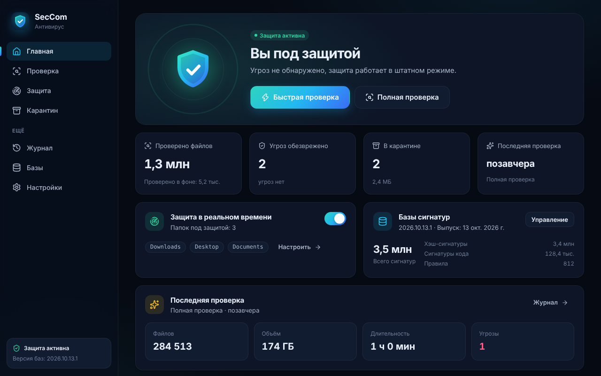
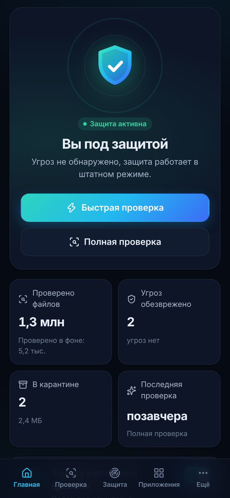
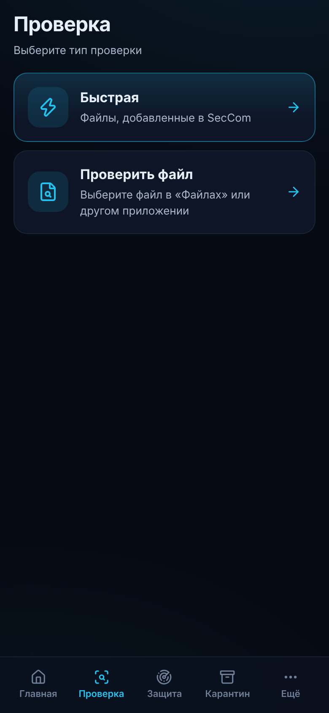

# SecCorp — антивирус на Rust

SecCorp — антивирус с собственным движком на Rust и современным интерфейсом
(Tauri 2 + React). Одна кодовая база, четыре независимые сборки:
**Windows**, **macOS**, **Android** и **iOS**.

| Windows / macOS | Android | iOS |
|---|---|---|
|  |  |  |

Издатель: **webnetkz** · идентификатор: `com.webnetkz.seccom` · интерфейс: русский и английский.

## Возможности

**Движок (`crates/engine`, чистый Rust, без C-зависимостей)**

- Сигнатуры по хэшам SHA-256 / SHA-1 / MD5 (форматы ClamAV `.hdb/.hsb/.hdu/.hsu`, `.cvd/.cld/.cud`,
  списки и CSV-экспорт MalwareBazaar), белые списки `.fp/.sfp/.ign/.ign2`.
- Сигнатуры по содержимому (ClamAV `.ndb`): быстрый поиск Aho-Corasick и точная проверка регулярными выражениями.
- Правила в стиле YARA: строки, hex с масками и прыжками, regex, `at`, `in`, `of`, `filesize`, `uint16/32`.
- Эвристики: двойные расширения и RTLO в именах, упакованные PE/ELF/Mach-O, макросы Office (VBA),
  активное содержимое PDF, обфусцированные скрипты, опасные разрешения в APK.
- Проверка внутри архивов ZIP / GZIP / TAR / APK / JAR / DOCX с защитой от «архивных бомб».
- Зашифрованный карантин (ChaCha20-Poly1305), кэш уже проверенных файлов, многопоточная проверка
  с паузой и отменой, защита в реальном времени.
- Обновления баз, подписанные Ed25519: проверка подписи и SHA-256, откат, защита от понижения версии.

**Приложение (`app/`)**

- Главный экран со статусом защиты, быстрая / полная / выборочная проверка, проверка отдельного файла.
- Угрозы: в карантин, удалить, доверять, пропустить; карантин с восстановлением; журнал и отчёты HTML/JSON.
- Защита в реальном времени, расписание проверок, автозагрузка и трей (Windows и macOS).
- Android: проверка установленных приложений и их разрешений, фоновая служба для новых загрузок и установок,
  проверка безопасности устройства (блокировка экрана, режим разработчика, отладка по USB, шифрование).
- iOS: проверка файлов из «Файлов» и меню «Поделиться», проверка блокировки экрана и биометрии.
- Тёмная и светлая темы, русский и английский языки, адаптивная вёрстка для телефонов и планшетов.

## Структура

```
crates/engine/                     движок: сигнатуры, правила, эвристики, архивы, карантин, обновления
crates/cli/                        seccom-cli — консольный сканер
tools/sigtool/                     sigtool — сборка и подпись обновлений баз
plugins/tauri-plugin-seccom-device/  нативный плагин: Kotlin (Android) и Swift (iOS)
app/                               интерфейс (React + TypeScript) и бэкенд Tauri (app/src-tauri)
signatures/                        исходники баз и тестовые файлы
build/{windows,macos,android,ios}/ скрипты отдельных сборок
.github/workflows/                 CI: отдельный workflow для каждой платформы
docs/ARCHITECTURE.md               устройство проекта
```

## Что нужно для сборки

| Сборка | Где собирать | Инструменты |
|---|---|---|
| Windows | Windows 10/11 | Rust ≥ 1.88, Node.js 22 LTS, Visual Studio 2022 Build Tools («Разработка классических приложений на C++») |
| macOS | Mac (macOS 13+) | Rust, Node.js, Xcode Command Line Tools |
| Android | macOS, Windows или Linux | Rust, Node.js, JDK 17, Android SDK + NDK 27 (`ANDROID_HOME`, `NDK_HOME`) |
| iOS | Mac | Rust, Node.js, Xcode 15+, аккаунт Apple Developer |

Готовые приложения работают на Windows 10+, macOS 12+, Android 8.0+ (API 26) и iOS 15+.

## Сборки

Каждая платформа собирается своим скриптом и независимо от остальных.
Готовые файлы складываются в `dist-release/<платформа>/`.

### Windows

```powershell
powershell -ExecutionPolicy Bypass -File build\windows\build.ps1            # x64: .exe (NSIS) и .msi
powershell -ExecutionPolicy Bypass -File build\windows\build.ps1 -Arch both # + ARM64 (NSIS)
```

Подпись кода: задайте `SECCOM_WINDOWS_SIGN_COMMAND`, например
`signtool sign /fd SHA256 /tr http://timestamp.digicert.com /td SHA256 /a "%1"`.
Без подписи SmartScreen будет предупреждать при установке.

### macOS

```bash
./build/macos/build.sh                              # универсальная сборка (Apple Silicon + Intel): .app и .dmg
./build/macos/build.sh --arch arm64 --no-dmg --install   # тестовая сборка: сразу в /Applications
```

**Подпись обязательна даже для тестов.** macOS запоминает «Полный доступ к диску» и другие
разрешения только для подписанного приложения; неподписанное будет снова и снова спрашивать
доступ к Рабочему столу, Документам и Загрузкам. Скрипт выбирает подпись сам:

1. `APPLE_SIGNING_IDENTITY`, если задана;
2. сертификат «Developer ID Application» или «Apple Development» из связки ключей
   (бесплатный «Apple Development» создаётся в Xcode → Settings → Accounts → Manage Certificates);
3. локальный сертификат «SecCorp Local Signing» — создайте его один раз командой
   `./build/macos/create-signing-cert.sh` (только для своего Mac);
4. иначе ad-hoc-подпись: тогда после каждой пересборки доступ к диску придётся выдавать заново.

После установки: Системные настройки → Конфиденциальность и безопасность → Полный доступ к диску →
включите SecCorp и перезапустите приложение (macOS применяет доступ только после перезапуска).
Если в списке осталась старая сборка, удалите её кнопкой «−» и добавьте новую кнопкой «+»
(или пересоберите с `--reset-permissions`). Без полного доступа SecCorp не дёргает систему
запросами: защищённые папки пропускаются, а приложение показывает, как выдать доступ.

Для распространения вне App Store нужны «Developer ID Application» и нотаризация:
`APPLE_ID` + `APPLE_PASSWORD` (пароль приложения) + `APPLE_TEAM_ID` или ключ API
(`APPLE_API_KEY`, `APPLE_API_ISSUER`, `APPLE_API_KEY_PATH`) — Tauri нотаризирует сборку сам.

### Android

```bash
export ANDROID_HOME=~/Library/Android/sdk          # путь к Android SDK
./build/android/build.sh                           # APK и AAB для arm64, armv7, x86_64
./build/android/build.sh --aab                     # только AAB для Google Play
./build/android/build.sh --apk --split-per-abi     # отдельный APK на каждую архитектуру
```

При первом запуске скрипт создаёт Android-проект (`tauri android init`) и добавляет в него
подпись релиза. Ключ берётся из переменных окружения и никуда не копируется:

```bash
export SECCOM_ANDROID_KEYSTORE=/путь/к/release.jks
export SECCOM_ANDROID_KEYSTORE_PASSWORD=...
export SECCOM_ANDROID_KEY_ALIAS=...
export SECCOM_ANDROID_KEY_PASSWORD=...    # если отличается от пароля хранилища
```

Новый ключ создаётся так (храните его и пароли вне репозитория):
`keytool -genkey -v -keystore release.jks -keyalg RSA -keysize 4096 -validity 10000 -alias seccom`.

### iOS

```bash
export APPLE_DEVELOPMENT_TEAM=XXXXXXXXXX   # Team ID из developer.apple.com → Membership
./build/ios/build.sh                       # .ipa для App Store Connect / TestFlight
./build/ios/build.sh --export release-testing
./build/ios/build.sh --simulator           # запуск в симуляторе для разработки
```

Загрузка в TestFlight:
`xcrun altool --upload-app --type ios --file dist-release/ios/SecCorp.ipa --apiKey <KEY_ID> --apiIssuer <ISSUER_ID>`.

## Разработка

```bash
cd app
npm install
npm run tauri dev          # настольное приложение с горячей перезагрузкой
npm run dev                # только интерфейс в браузере (демо-данные)
```

Интерфейс в браузере работает на демо-бэкенде. Параметры адреса позволяют посмотреть любую платформу:
`http://localhost:1420/?platform=android&lang=ru&theme=dark` (также `ios`, `macos`, `windows`;
`&threats=1` — с угрозами, `&onboarding=1` — первый запуск).

Тесты и проверки:

```bash
cargo test -p seccom-engine -p seccom-cli -p seccom-sigtool
cargo clippy --workspace --all-targets
(cd app && npm run build)
```

Консольный сканер:

```bash
cargo run --release -p seccom-cli -- scan ~/Downloads
cargo run --release -p seccom-cli -- scan --json --heuristics high --exclude "*.iso" /path
cargo run --release -p seccom-cli -- --db signatures/base info
```

Код возврата `seccom-cli scan`: 0 — угроз нет, 1 — найдены угрозы, 2 — ошибка.

## Обновление баз сигнатур

1. Один раз создайте ключи: `cargo run -p seccom-sigtool -- keygen --out ~/seccom-keys`.
   **Секретный ключ `update_signing.key` никогда не кладите в репозиторий** — `.gitignore` уже
   исключает `*.key` и папку `keys/`.
2. Соберите приложения с публичным ключом и адресом обновлений:

   ```bash
   export SECCOM_UPDATE_PUBKEY=$(cat ~/seccom-keys/update_signing.pub)
   export SECCOM_UPDATE_URL=https://updates.example.com/seccom/update.json
   ```

   Без `SECCOM_UPDATE_PUBKEY` онлайн-обновления выключены, ручной импорт баз продолжает работать.
3. Каждый выпуск баз: `sigtool build` → загрузить `seccom-db-<версия>.tar.gz` и `update.json`
   на HTTPS-сервер. Подробно — в [signatures/README.md](signatures/README.md).

Приложение проверяет обновления каждые 6 часов (можно выключить) и принимает только пакеты
с правильной подписью и версией новее установленной.

Если собственный подписанный канал не задан, desktop-сборка автоматически использует установленный
FreshClam и подхватывает официальные базы ClamAV из стандартного системного каталога. Форматы
`.cvd`, `.cld`, `.hdb`, `.hsb`, `.ndb`, YARA и списки хэшей также можно импортировать вручную.

## CI (GitHub Actions)

| Workflow | Что делает |
|---|---|
| `ci.yml` | тесты движка, clippy, сборка интерфейса — на каждый push и pull request |
| `build-windows.yml` | `.exe` и `.msi` |
| `build-macos.yml` | универсальные `.app` и `.dmg` |
| `build-android.yml` | `.apk` и `.aab` |
| `build-ios.yml` | `.ipa` |

Сборки запускаются вручную (Actions → Run workflow) или по тегу `v*`, каждая отдельно.
Настройки репозитория:

- Variables: `SECCOM_UPDATE_PUBKEY`, `SECCOM_UPDATE_URL`, `APPLE_DEVELOPMENT_TEAM`.
- Secrets (все необязательны, кроме iOS):
  - Windows — `SECCOM_WINDOWS_SIGN_COMMAND`;
  - macOS — `APPLE_CERTIFICATE` (base64 от .p12), `APPLE_CERTIFICATE_PASSWORD`, `APPLE_ID`, `APPLE_PASSWORD`, `APPLE_TEAM_ID`;
  - Android — `ANDROID_KEYSTORE_BASE64`, `ANDROID_KEYSTORE_PASSWORD`, `ANDROID_KEY_ALIAS`, `ANDROID_KEY_PASSWORD`;
  - iOS — `APPLE_API_KEY` (Key ID), `APPLE_API_ISSUER`, `APPLE_API_KEY_P8` (содержимое .p8).

## Ограничения платформ

- **Windows.** Защита в реальном времени проверяет файлы сразу после записи (уведомления файловой
  системы), но не блокирует запуск. Блокировка «до открытия» требует драйвера-минифильтра ядра,
  подписанного Microsoft, а регистрация в «Безопасности Windows» вместо Defender — участия
  в программе Microsoft Virus Initiative. В проект это не входит; SecCorp работает рядом с Defender.
- **macOS.** Аналогично: защита работает через FSEvents. Блокировка «до открытия» возможна только через
  Endpoint Security, для которой Apple выдаёт отдельное разрешение (entitlement) по заявке. Приложение
  распространяется вне Mac App Store (Developer ID + нотаризация), так как песочница App Store
  не позволит проверять весь диск.
- **Android.** Для полной проверки памяти и списка приложений нужны разрешения «Доступ ко всем файлам»
  и QUERY_ALL_PACKAGES. Google Play разрешает их антивирусам, но в Play Console нужно заполнить
  декларации, а для фоновой службы (`specialUse`) — описать её назначение. Удалить приложение
  без подтверждения пользователя Android не позволяет: SecCorp открывает системный диалог.
  Приватные данные других приложений недоступны.
- **iOS.** Система не позволяет приложениям проверять файлы других приложений или систему.
  SecCorp проверяет файлы, которые пользователь сам передал («Файлы», «Поделиться», «Открыть в»),
  и настройки безопасности устройства. Apple не пропускает в App Store приложения, которые
  обещают «антивирусную защиту iPhone», поэтому в iOS-версии SecCorp описан как проверка файлов
  и безопасности — придерживайтесь этого и в описании для App Store.

## Безопасность

- Ключ шифрования карантина создаётся при первом запуске и хранится в папке данных приложения
  (на macOS доступен только владельцу). Файлы в карантине зашифрованы, поэтому их нельзя
  случайно запустить или открыть.
- Обновления баз принимаются только по HTTPS, с проверкой подписи Ed25519 и SHA-256 пакета.
- Приложение ничего не отправляет на серверы: проверка полностью локальная.
